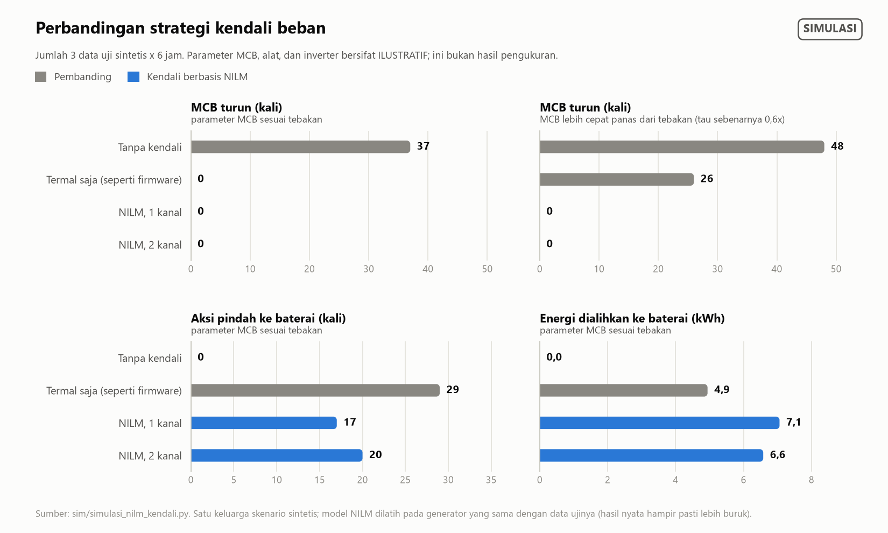

# TAMBAH DAYA VIRTUAL

Sistem pengenalan beban non-intrusif (NILM) dan kendali cerdas beban dan baterai agar UMKM dapat **menambah kapasitas produksi tanpa menaikkan daya PLN**.

Proyek untuk UNS Innovation Hackathon 2026, Sub-tema A (energi terbarukan dan penyimpanan untuk fasilitas publik dan UMKM).

> **Status: tahap konsep, TKT 3.** Yang ada saat ini adalah simulasi, alur analisis yang diuji pada data sintetis, firmware yang logikanya diuji di komputer tetapi belum pernah dijalankan di ESP32, dan dasbor yang belum pernah dicoba dengan data perangkat. Belum ada hasil pengukuran. Jangan mengutip angka dari repositori ini sebagai kinerja alat.

## Cara kerja singkat

1. Satu sensor arus dan tegangan di panel mengenali alat yang menyala (NILM).
2. Model termal MCB menghitung seberapa dekat MCB ke batas turun.
3. Bila hampir turun, sistem menunda alat yang boleh ditunda (relay) atau memindahkan satu alat ke baterai dan inverter (sakelar pindah).
4. Dasbor menampilkan daya, alat aktif, pemanasan MCB, log aksi, dan tambahan daya efektif.

Pembeda dari produk smart panel di luar negeri: satu sensor di panel yang sudah ada (tanpa mengganti panel), untuk listrik 220 V UMKM Indonesia, dengan biaya jauh lebih rendah.

## Isi repositori

| Folder | Isi |
|---|---|
| `docs/` | proposal (Word dan PDF), diagram blok, grafik simulasi |
| `docs/daftar_komponen.md` | komponen panel uji dan harga acuan |
| `docs/pengkabelan.md` | pengkabelan panel uji, uji kering relay, langkah pertama kali diberi tegangan |
| `sim/` | simulasi MCB dan kendali, pembuat data contoh, rekaman tiruan untuk demo |
| `firmware/esp32_panel/` | firmware ESP32: P, Q, model termal MCB, relay (belum dijalankan di ESP32) |
| `firmware/uji_relay/` | sketsa uji kering relay, dijalankan tanpa 220 V |
| `firmware/uji_host/` | uji logika firmware di komputer (butuh g++) |
| `uji_semua.py` | menguji seluruh alur dengan satu perintah |
| `uji_kasus_tepi.py` | uji kasus tepi (data kosong/pendek, nilai ekstrem, aturan keputusan kendali) |
| `alat/` | perekam serial ESP32 ke CSV |
| `analisis/` | deteksi event, klasifikasi alat, disagregasi, model MCB, dataset publik, data sintetis |
| `dashboard/` | dasbor Streamlit: halaman utama, `simulator.py`, `tampilan.py`, `logika.py` (fungsi hitung), `pages/` (halaman rekaman) |
| `data/` | skema data dan data contoh simulasi |
| `docs/protokol_uji.md` | langkah rekam alat, uji trip MCB, uji kendali |
| `docs/logbook.md` | templat logbook eksperimen |

## Mulai cepat

```bash
python -m venv .venv
source .venv/bin/activate            # Windows: .venv\Scripts\activate
pip install -r requirements.txt
python sim/simulasi_mcb.py           # membuat data contoh dan grafik
streamlit run dashboard/app.py       # membuka dasbor
```

## Menguji semua kode

```bash
python uji_semua.py
```

Perintah ini menjalankan tiga belas langkah (simulasi, data sintetis, deteksi event, klasifikasi, disagregasi,
model MCB, perekam mode uji, fungsi dasbor, logika firmware, kecocokan antar-halaman dasbor, kendali berbasis NILM) dan mencetak LULUS atau GAGAL per langkah.
Berkas di repositori tidak diubah. Langkah logika firmware dilewati bila `g++` tidak terpasang.
Semua datanya sintetis: uji ini membuktikan kode berjalan, bukan kinerja alat.

```bash
python uji_kasus_tepi.py        # kasus tepi: data kosong/pendek, NaN, baris serial rusak, aturan keputusan kendali
```

Uji kasus tepi memanggil fungsi langsung (sekitar 2 detik). Kekurangan yang sudah diketahui tetapi belum diperbaiki
ditandai `CELAH` (tidak membuat uji gagal; pakai `--ketat` bila ingin menganggapnya gagal).

## Dasbor

```bash
python sim/rekaman_tiruan.py         # sekali saja: data tiruan untuk halaman kedua
streamlit run dashboard/app.py
```

Dasbor punya dua halaman (pilih di menu kiri):

1. **Halaman utama** (`dashboard/app.py`): data dua skenario (tanpa dan dengan kendali) dari simulasi atau
   CSV yang diunggah. Tab: putar ulang panel (mode demo), grafik arus dan MCB, alat dan kendali,
   simulator apa-jika, validasi, data, dan tentang sistem.
2. **Rekaman dan Pengenalan Alat** (`dashboard/pages/`): membaca rekaman ESP32 di `data/raw` (hasil
   `alat/perekam_serial.py`, bisa disegarkan otomatis saat merekam), rekaman tiruan, atau CSV yang diunggah.
   Menampilkan arus terhadap batas MCB, pemanasan MCB menurut model, perkiraan waktu sebelum MCB turun,
   alat yang dikenali menyala (bila sudah ada `laporan/<nama>/model.joblib`), log aksi, dan ringkasan.
   Bisa diputar ulang dari awal. Parameter MCB dibaca dari hasil `analisis/fit_mcb.py` bila ada.

Semua data contoh adalah simulasi dan ditandai begitu di dasbor.

## Alur kerja NILM dan model MCB

Coba seluruh alur dengan data sintetis (tanpa perangkat keras):

```bash
python analisis/data_sintetis.py --jam 6 --keluaran data/sample/agregat_sintetis.csv
python analisis/deteksi_event.py data/sample/agregat_sintetis.csv --keluaran data/olah/event_agregat.csv
python analisis/latih_klasifikasi.py data/olah/event_agregat.csv --kebenaran data/sample/agregat_sintetis_event.csv --keluaran laporan/klasifikasi_sintetis
python analisis/data_sintetis.py --jam 6 --seed 9 --keluaran data/sample/agregat_uji.csv
python analisis/disagregasi.py data/sample/agregat_uji.csv laporan/klasifikasi_sintetis/model.joblib
```

Dengan data nyata (lihat `docs/protokol_uji.md`):

```bash
# rekam tiap alat sendirian, deteksi event berlabel, latih
python alat/perekam_serial.py --port COM5 --sesi setrika_uap --durasi 900
python analisis/deteksi_event.py data/raw/setrika_uap_*.csv --label setrika_uap --keluaran data/olah/ev_setrika_uap.csv
python analisis/latih_klasifikasi.py data/olah/ev_*.csv --keluaran laporan/klasifikasi_v1

# parameter model termal MCB dari uji waktu trip
python analisis/fit_mcb.py data/raw/uji_trip_mcb4A.csv --in-mcb 4 --keluaran laporan/mcb4A

# (opsional) event dari dataset publik UK-DALE / REDD untuk pra-latih atau uji kode
python analisis/dataset_publik.py --folder PATH/ukdale/house_1 --daftar
```

Model klasifikasi yang dibandingkan: pohon keputusan (mudah dijelaskan), random forest, dan jaringan saraf
kecil (MLP). Fitur saat ini: perubahan daya aktif dan reaktif, rasionya, dan lonjakan arus saat start.
Model jaringan saraf konvolusi (CNN 1D) pada bentuk gelombang belum dibuat; itu butuh data berfrekuensi
tinggi dari ESP32 dan pustaka seperti PyTorch atau TensorFlow.

Hasil pada data sintetis (hanya untuk menguji kode, bukan kinerja alat): deteksi event menangkap sekitar
95% event; pada tiga data uji, status alat besar (setrika, oven, mixer) terlacak 95-100% dari waktu,
sedangkan alat kecil (lampu/kipas, freezer, mesin jahit) 77-99%. Alat kecil yang berubah status
bersamaan dengan alat besar adalah bagian tersulit.

Pola berkas seperti `data/raw/setrika_uap_*.csv` diperluas oleh skrip sendiri, sehingga perintah di atas
berjalan sama di PowerShell, CMD, dan terminal Linux/Mac. Rekaman ESP32 yang berisi beberapa baris per detik
dirata-rata menjadi satu baris per detik sebelum dianalisis.

## Kendali berbasis NILM (baru disimulasikan)

Kendali di firmware (`esp32_panel.ino`) hanya memakai model termal MCB dan memindahkan alat yang terpasang di relay,
tanpa tahu alat itu sedang menyala atau tidak. Hasil NILM kini bisa dipakai untuk memutuskan **alat mana** yang
dipindah dan **kapan aman** dikembalikan:

| Berkas | Isi |
|---|---|
| `analisis/keputusan_kendali.py` | aturan keputusan (fungsi murni, mudah diuji): pindah, kembali, peringatan, atau tunggu |
| `analisis/pengendali_nilm.py` | pengendali online, 1 sampel per detik: deteksi event, klasifikasi, pelacakan status, lalu keputusan |
| `sim/simulasi_nilm_kendali.py` | simulasi loop tertutup yang membandingkan strategi pada beban yang sama |

Aturan intinya:
1. Hanya alat yang **menurut NILM sedang menyala** dan terpasang di kanal relay yang dipertimbangkan; yang dipilih
   adalah yang paling banyak meredam beban, dengan memperhitungkan kapasitas inverter.
2. Alat dikembalikan ke PLN hanya bila pemanasan MCB sudah turun, alat cukup lama di baterai, **dan** daya alat itu
   (dari NILM) tidak membuat beban melewati batas lagi. Ini mencegah bolak-balik pindah.
3. **Jaring pengaman:** bila NILM tidak menemukan kandidat padahal pemanasan sudah melewati ambang aman, perilakunya
   sama dengan kendali termal. NILM yang keliru tidak boleh lebih buruk daripada firmware sekarang.
4. Kompresor (freezer, kulkas, AC) ditolak di tingkat konfigurasi: tidak boleh dipasang pada kanal pindah.

```bash
python sim/simulasi_nilm_kendali.py                  # 3 data uji x 6 jam, sekitar 2,5 menit
python sim/simulasi_nilm_kendali.py --salah-tau 0.6  # MCB sebenarnya lebih cepat panas dari tebakan
```

Hasil **simulasi** (data sintetis, parameter ilustratif: MCB 10 A, tau 900 s, ambang trip 1,45, inverter 2500 VA;
jumlah dari 3 data uji masing-masing 6 jam; model NILM dilatih pada data lain):

| Skenario | MCB turun | Aksi pindah | Menit di baterai | Energi ke baterai (kWh) |
|---|---|---|---|---|
| tanpa kendali | 37 | 0 | 0 | 0 |
| termal saja, 1 kanal (seperti firmware) | 0 | 29 | 226 | 4,9 |
| NILM, 1 kanal | 0 | 17 | 387 | 7,1 |
| NILM, 2 kanal (setrika dan oven) | 0 | 20 | 373 | 6,6 |
| *bila tau sebenarnya 0,6x tebakan:* tanpa kendali / termal / NILM 1 kanal / NILM 2 kanal | 48 / 26 / 0 / 0 | | | |



Gambar di atas dibuat ulang dengan `python sim/simulasi_nilm_kendali.py --gambar docs/simulasi_kendali_nilm.png` (sekitar 5 menit). Semua angkanya simulasi.

Cara membacanya, dengan jujur:
- Bila parameter MCB diketahui benar, kendali termal saja **sudah mencegah MCB turun** pada skenario ini. NILM tidak
  menambah pencegahan, tetapi memindah **lebih jarang** (17 berbanding 29) karena tidak bolak-balik.
- Harganya: alat bertahan di baterai lebih lama, sehingga energi baterai yang dibutuhkan sekitar 43% lebih besar.
  Ukuran baterai dan inverter harus mengikuti angka ini.
- Bila MCB asli lebih cepat panas daripada tebakan, kendali termal saja gagal (26 kali turun), sedangkan NILM tidak
  (0). Penyebabnya belum dipisahkan: kemungkinan karena bertindak lebih awal dan menahan alat di baterai lebih
  lama. Ini alasan lain parameter MCB harus diukur (`analisis/fit_mcb.py`).
- Dua kanal tidak lebih baik daripada satu pada skenario ini. Satu kali NILM memindah alat yang ternyata sedang mati.
- Batas: satu keluarga skenario sintetis; model NILM dilatih pada generator yang sama dengan data ujinya (hasil
  pada alat UMKM nyata hampir pasti lebih buruk); parameter semuanya ilustratif. **Belum ada di firmware.**

## Batas simulasi

- Aturan kendali pada simulasi sangat sederhana dan hanya untuk menguji alur. Logika di firmware dan model NILM harus dikembangkan dan diuji terpisah.
- Parameter model termal MCB (konstanta waktu, ambang) adalah tebakan ilustratif. Ganti dengan nilai dari datasheet dan uji waktu trip MCB yang dipakai.
- Kolom `alat_aktif` pada data simulasi adalah label skenario, bukan keluaran model NILM.
- Simulasi kendali NILM memakai model yang dilatih pada generator data sintetis yang sama dengan data ujinya, jadi akurasinya optimistik.

## Yang harus dikerjakan berikutnya

- [ ] Jalankan `python uji_semua.py` di laptop tiap anggota; coba dasbor dan mode demo di Streamlit
- [ ] Beli komponen (`docs/daftar_komponen.md`); kompilasi firmware di Arduino IDE
- [ ] Rakit panel uji di laboratorium (`docs/pengkabelan.md`); lakukan uji kering relay
- [ ] Ukur waktu trip MCB pada 4-6 tingkat arus; jalankan `analisis/fit_mcb.py`
- [ ] Rekam 5-8 alat, masing-masing 10x nyala-mati; latih `analisis/latih_klasifikasi.py`
- [ ] Rekam kombinasi alat dan uji `analisis/disagregasi.py`
- [ ] Uji kendali: relay dan sakelar pindah dengan inverter dan baterai
- [ ] Ukur: jumlah MCB turun sebelum dan sesudah kendali; akurasi pengenalan alat
- [x] Sambungkan hasil pengenalan alat ke keputusan kendali: **sudah di perangkat lunak dan simulasi**
      (`analisis/pengendali_nilm.py`), belum di perangkat keras
- [ ] Jalankan kendali NILM pada perangkat: firmware tidak bisa menjalankan scikit-learn. Pilihan: komputer/Raspberry Pi
      menjalankan pengendali dan mengirim perintah ke ESP32 lewat serial (firmware perlu perintah pindah/kembali dan
      watchdog yang mengembalikan alat ke PLN bila perintah berhenti), atau pohon keputusan diekspor ke C
- [ ] Pantau tegangan aki di firmware
- [ ] Hubungkan firmware ke basis data (opsional; dasbor sudah bisa membaca rekaman di `data/raw`)

## Keselamatan

Proyek ini memutus dan menyambung beban 220 V. Ikuti `docs/pengkabelan.md` dan aturan di komentar `firmware/esp32_panel/esp32_panel.ino`: relay fail-safe ke PLN, sakelar pindah putus-dulu-baru-sambung, keluaran inverter tidak pernah tersambung ke jaringan PLN, tidak menyentuh MCB pembatas PLN, RCBO di setiap panel uji, uji kering sebelum diberi tegangan, dan uji pertama di laboratorium dengan pendampingan dosen.

## Catatan orisinalitas

NILM berasal dari Hart (1992) dan sudah diteliti di Indonesia (antara lain di ITB). Pengaturan beban dan baterai agar tidak perlu naik daya sudah dijual di luar negeri dalam bentuk smart panel. Lihat daftar pustaka di proposal. Bila memakai kode atau data dari riset lain, sebutkan sumbernya dan periksa izinnya.

## Lisensi

Belum ditentukan. Tanpa lisensi, semua hak dipegang tim. Tentukan lisensi setelah masa seleksi dan penjurian selesai.
